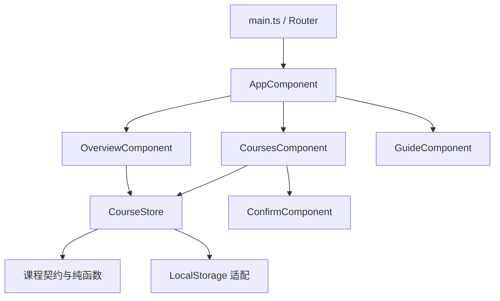

# Angular 教学版架构

## 为什么升级

Angular 6 的构建器、TSLint、旧 HTTP 模块和第三方管理后台依赖不适合作为当前教学起点。新主线固定 Angular/Material 21.2.0 和 TypeScript 5.9.3，使用标准 CLI 应用构建器、独立组件和无 Zone 变更检测。保留目录名不表示兼容原工具链。

## 模块关系

页面负责交互，不直接维护持久化格式；Store 持有唯一课程集合和计算统计；领域层不依赖 Angular，因此可独立运行单元测试。当前存储逻辑规模很小，集中在 Store，真正接入 HTTP 或 IndexedDB 时再提取 Repository 接口。

## 状态与数据

状态采用 signal，导出只读信号；stats 和筛选结果使用 computed。添加课程先校验，完成操作通过创建新对象更新，避免原地修改导致派生状态不刷新。

持久化格式为 version=1 与 courses 数组。解析时限制数量、字段、分类、时长和重复 id；仅保留已知字段。加载失败回退示例并显示提示，不在读取时覆盖原文件。写入失败仍允许当前页面继续操作，但明确显示“仅本次页面有效”。

统计按分钟加权：完成一节 25 分钟课程与完成一节 45 分钟课程的贡献不同；空课程列表的进度为 0。

## 表单与组件

课程表单使用 nonNullable FormBuilder 与显式分类类型。控件验证负责即时反馈，validateCourse 负责最终业务边界。Material 对话框通过数据注入接收文案，确认后才删除或重置；不是使用 alert 假装确认。

页面路由懒加载。全局样式只处理页面布局和主题，组件库负责表单和对话框基础交互；不加载外部字体、图片或业务接口。

## 测试与扩展

领域测试验证类型之外的运行时边界，浏览器测试验证添加/完成/刷新/删除完整流程。未来接入 Express 教学 API 时应先定义数据映射：本项目是 Course，Express 示例是 Task，不能假定接口可直接互换。可作为扩展课设计自己的 Course API 与 HTTP Repository。

生产化还需认证、权限、服务端数据约束、可观测性和真实设备验收；当前以独立可运行、清晰可读为目标。
